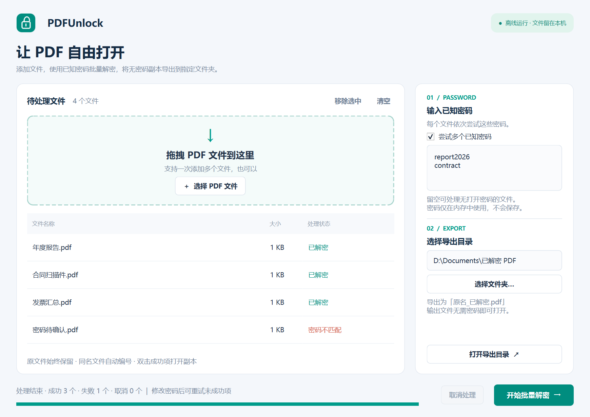

# PDFUnlock - PDF 批量解密桌面工具 / 命令行工具

PDFUnlock 提供中文桌面界面和命令行工具。桌面版支持拖入多个 PDF，使用一个或多个已知密码批量解密，并将无密码副本保存到自选目录。命令行同样仅支持已知密码解密与去除无打开密码文件的限制。仅处理已知密码，不包含密码破解代码。

[下载 Windows 便携版](https://github.com/zajanmy/PDFUnlock/releases/latest) · [源代码](https://github.com/zajanmy/PDFUnlock)

## 桌面版



1. 双击 `PDFUnlock.exe`，或按下方源码方式启动。
2. 将多个 PDF 拖入窗口，或点击「选择 PDF 文件」。自动忽略重复路径和非 PDF 文件。
3. 输入已知密码；不同文件使用不同密码时，勾选「尝试多个已知密码」，每行填写一个。多个密码会明文显示，首尾空格会保留。
4. 选择导出目录，点击「开始批量解密」。每个文件会依次尝试输入的密码；不需要打开密码的 PDF 可留空处理。
5. 点击「打开导出目录」，或双击成功项打开输出文件。

原文件不会修改。输出为 `原名_已解密.pdf`，遇到重名自动追加 `_1`、`_2` 等编号。无加密文件也会导出副本。单个文件密码错误、损坏或不可读取时，会显示失败原因并继续其他文件；鼠标停在状态上可查看完整说明。

修改密码后再次开始，只重试失败或取消的项目。成功项不会重复导出；如需将其另存到其他目录，请清空列表后重新添加。取消会在当前打开/保存操作结束后停止，已完成的文件会保留。关闭处理中的窗口也会先安全停止。

所有处理在本机完成，不上传 PDF，不保存密码。桌面版只尝试用户提供的已知密码，不进行自动密码穷举。

**User Password 和 Owner Password 均支持**：文件同时设置两种密码时，提供其中任一有效密码即可导出无加密副本；只有 Owner 限制、无需密码即可打开的文件可以留空处理。

### Windows 便携 EXE

构建产物为 `dist/PDFUnlock.exe`，面向 **Windows 10（1809 或更新）/11 x64**，与 [Qt 6.12 支持的平台](https://doc.qt.io/qt-6.12/windows.html)一致。复制这一个文件到另一台兼容的电脑即可运行，无需安装 Python、Qt 或 qpdf。首次启动需要将内置组件解包到系统临时目录，可能稍有延迟。

在 Windows 构建电脑安装 Python 3.10+ 后执行（推荐使用 Python 3.13 x64）：

```powershell
powershell -ExecutionPolicy Bypass -File .\scripts\build_windows.ps1
```

脚本会创建本地虚拟环境、安装依赖、运行测试、打包无控制台的单文件 EXE，并移除 Python 环境变量、缩减 PATH 后运行 EXE 自检。输出还包括 `dist/PDFUnlock.exe.sha256` 校验值。自检报告及实际窗口截图位于 `build/smoke-*/`。

也可以手动构建：

```powershell
python -m pip install -r requirements-build.txt
python -m pytest -q
python -m PyInstaller --noconfirm --clean PDFUnlock.spec
```

GitHub Actions 的 **Build Windows desktop** 工作流支持手动触发或推送 `v*` 标签，构建后可下载 `PDFUnlock-windows-x64` artifact。它不会自动创建 GitHub Release；发布时可将 EXE 和校验值作为 Release 附件。

EXE 未做代码签名。Windows 可能显示未知发布者提示；正式发行时可使用自己的代码签名证书。此构建不支持 Windows 7/8，也不是 macOS/Linux 可执行文件。运行环境依赖由 [PyInstaller 的单文件打包机制](https://www.pyinstaller.org/en/stable/operating-mode.html)内置。

### 从源码启动 UI

```bash
python -m pip install -r requirements-gui.txt
python -m pdfunlock --gui
# 或 python -m pdfunlock.gui
```

只使用命令行时不需要安装 Qt。

> **免责声明：** 本项目仅供代码学习和研究使用，禁止用于非法用途。请仅对你拥有合法权限的文件使用本工具。使用本工具造成的任何后果由使用者自行承担。


## 命令行用法

安装命令行依赖：

```bash
python -m pip install -r requirements.txt
```

使用已知密码导出到指定目录：

```bash
python -m pdfunlock -f "文件.pdf" -m SinglePassword -p "已知密码" -o "导出目录"
```

处理不需要打开密码、但限制打印/复制的 PDF：

```bash
python -m pdfunlock -f "文件.pdf" -m RemoveRestrictions -o "导出目录"
```

省略 `-o` 时保存到源文件所在目录；控制台不会打印密码。支持标准 RC4、AES-128、AES-256 加密文件。PDF 损坏、密码错误或读写失败时会报告原因。

本项目不提供字典、暴力、掩码或断点续传功能。多个已知密码仅是用户输入的密码列表，不会自动生成候选密码或读取密码字典。

## 开发与验证

源码运行需要 Python 3.10+；桌面界面使用 PySide6 Essentials，PDF 引擎使用 pikepdf（其 wheel 内含 qpdf）。

- `pdfunlock/gui.py`：中文界面、文件拖拽、后台处理、进度及重试。
- `pdfunlock/batch.py`：已知密码批量解密与取消控制。
- `pdfunlock/output.py`：无密码导出及同名文件保护。
- `pdfunlock/cli.py`：已知密码命令行入口。
- `desktop.py`、`PDFUnlock.spec`：Windows EXE 入口与打包配置。
- `scripts/build_windows.ps1`：测试、打包及独立 EXE 自检。

```bash
python -m pytest -q
```

测试覆盖正确/错误密码、RC4 与 AES、Unicode 路径与密码、原文件保留、同名文件并发导出、损坏文件、取消、GUI 拖拽与重试，以及旧破解选项不可用。安装 `requirements-gui.txt` 后运行 GUI 测试；未安装 Qt 时仅跳过 GUI 测试。原破解模块、注释归档及对应测试均已移除。

打包产物可通过 `PDFUnlock.exe --self-test <报告目录>` 单独检查：它仅生成测试 PDF，验证无密码输出、源文件保留、窗口/后台任务，输出 JSON 报告及界面 PNG。构建脚本会将单独的 EXE 复制到临时目录，清除 Python/Qt 环境变量并缩减 PATH 后执行自检。

## 许可证

本项目以 [zajanmy/PDFUnlock](https://github.com/zajanmy/PDFUnlock) 开源，采用 MIT 许可证，见 [LICENSE](LICENSE)。当前发布仅包含已知密码解密桌面版的实现，不包含初始项目源码或历史。桌面发行包包含 Qt/PySide6、pikepdf/qpdf 等第三方组件，遵循各自许可，详见 [THIRD_PARTY_NOTICES.txt](THIRD_PARTY_NOTICES.txt) 和 `licenses/`。
